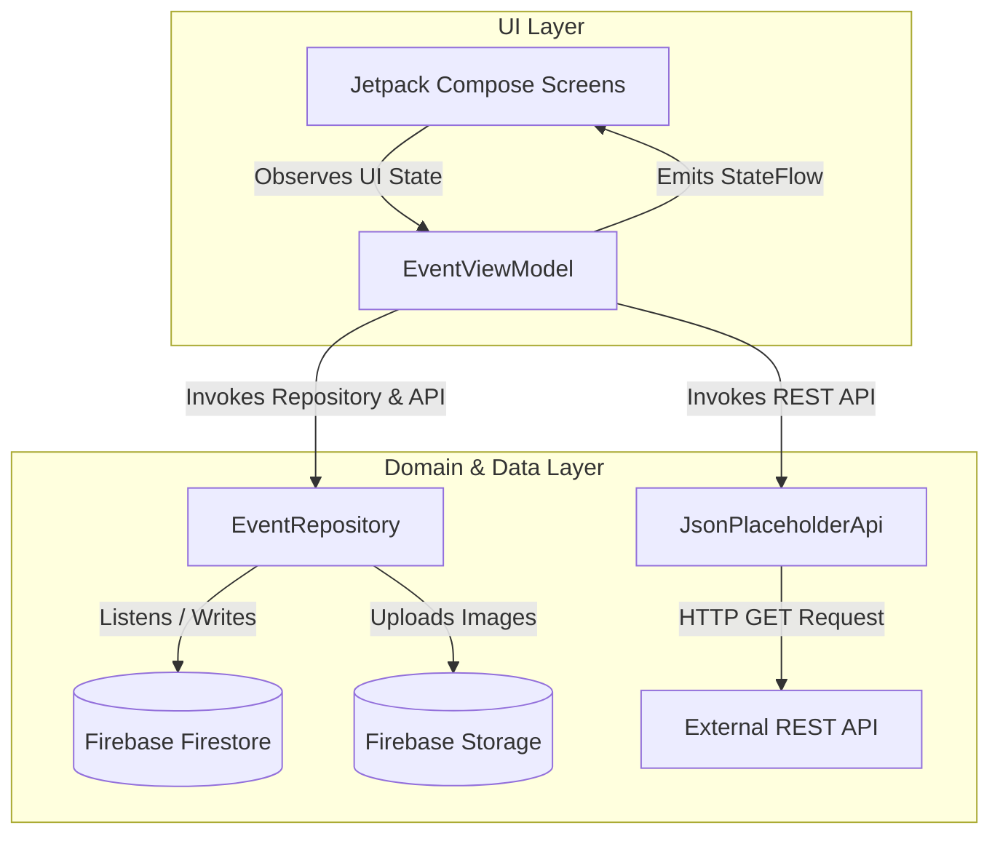

# Community Events Android App

[](https://www.android.com)
[](https://kotlinlang.org)
[](https://developer.android.com/jetpack/compose)
[](https://firebase.google.com)
[](https://developer.android.com/about/versions/oreo)
[](https://developer.android.com/about/versions/15)

A modern, responsive, and full-featured Android application for organizing and discovering local community events. Built natively with **Jetpack Compose**, **Material 3**, **Firebase Cloud Firestore**, **Firebase Cloud Storage**, **OkHttp**, and **Coil**.

---

## 📋 Table of Contents

- [Overview](#-overview)
- [Key Features](#-key-features)
- [App Architecture](#-app-architecture)
- [Tech Stack & Libraries](#-tech-stack--libraries)
- [Project Structure](#-project-structure)
- [Prerequisites](#-prerequisites)
- [Installation & Setup](#-installation--setup)
  - [Method 1: Android Studio (Recommended)](#method-1-android-studio-recommended)
  - [Method 2: Command Line (Gradle & ADB)](#method-2-command-line-gradle--adb)
- [Firebase Backend Setup](#-firebase-backend-setup)
- [REST API Integration](#-rest-api-integration)
- [Troubleshooting](#-troubleshooting)
- [Suggested Commit Messages](#-suggested-commit-messages)
- [License](#-license)

---

## 🌐 Overview

**Community Events** connects community members and event organizers by providing a real-time platform to discover, create, and share events. Organizers can list new events with custom title details, dates, locations, descriptions, and banner images. All event data is synchronized instantaneously across client devices using Firebase Cloud Firestore real-time snapshot listeners.

The application also features a REST API demonstration module using **OkHttp** to retrieve live external JSON payloads asynchronously off the main thread.

---

## ✨ Key Features

- 📱 **Real-Time Event Feed**:
  - Automatically listens for Firestore updates and streams live event data in chronological order.
  - Includes pull-to-retry mechanism, custom loading indicators, error handling, and friendly empty-state UI.

- 🔍 **Detailed Event View**:
  - Displays high-resolution event cover photos, event titles, formatted dates, locations, and multi-line descriptions.

- ➕ **Add Event Form & Image Upload**:
  - Integrated image picker supporting device media libraries.
  - Automatic image compression and asynchronous upload to **Firebase Cloud Storage**.
  - Client-side validation enforcing required fields and standardized date formatting (`YYYY-MM-DD`).

- ⚡ **REST API Demo**:
  - Asynchronous background HTTP GET request via **OkHttp** against the JSONPlaceholder API (`https://jsonplaceholder.typicode.com/posts/1`).
  - Safe JSON parsing (`org.json.JSONObject`) and coroutine dispatcher management (`Dispatchers.IO`).

- 🎨 **Material 3 Custom Theme**:
  - Clean blue-and-white color palette with custom Material 3 typography, full edge-to-edge layout support (`enableEdgeToEdge`), and smooth Compose Navigation screen transitions.

- 🚀 **Splash Screen**:
  - Professional branded startup screen providing a seamless entry flow into the main application feed.

---

## 🏗️ App Architecture

The app follows the official **Android Recommended Architecture Guidelines**, implementing the **MVVM (Model-View-ViewModel)** pattern combined with a **Repository Pattern** and **Unidirectional Data Flow (UDF)**.



### UI State Management
All UI screens consume reactive, immutable sealed interface states managed by Kotlin `StateFlow`:
- `EventsUiState`: `Loading` | `Empty` | `Success(events)` | `Error(message)`
- `AddEventUiState`: `Idle` | `Loading` | `Success` | `Error(message)`
- `ApiUiState`: `Idle` | `Loading` | `Success(post)` | `Error(message)`

---

## 🛠️ Tech Stack & Libraries

| Category | Technology / Library | Version | Purpose |
| :--- | :--- | :--- | :--- |
| **Language** | [Kotlin](https://kotlinlang.org/) | `2.0.21` | Core programming language |
| **Build System** | [Gradle (Kotlin DSL)](https://gradle.org/) | `8.7.3` | Build automation & dependency management |
| **UI Toolkit** | [Jetpack Compose](https://developer.android.com/jetpack/compose) | `2024.12.01 (BOM)` | Declarative UI framework |
| **Design System** | [Material 3](https://m3.material.io/) | Jetpack Compose | Modern Material Design UI components |
| **Navigation** | [Navigation Compose](https://developer.android.com/jetpack/compose/navigation) | `2.8.5` | In-app screen navigation & backstack routing |
| **Async & Flow** | [Kotlin Coroutines & Flow](https://kotlinlang.org/docs/coroutines-overview.html) | `1.9.0` | Asynchronous operations and reactive streams |
| **Database** | [Firebase Cloud Firestore](https://firebase.google.com/docs/firestore) | `33.7.0 (BOM)` | Cloud NoSQL database for real-time events |
| **Storage** | [Firebase Cloud Storage](https://firebase.google.com/docs/storage) | `33.7.0 (BOM)` | Object storage for event banners & images |
| **Image Loading** | [Coil Compose](https://coil-kt.github.io/coil/compose/) | `2.7.0` | Asynchronous image loading & caching for Compose |
| **Networking** | [OkHttp](https://square.github.io/okhttp/) | `4.12.0` | HTTP client for external REST API calls |

---

## 📁 Project Structure

```
CommunityEventsApp/
├── app/
│   ├── build.gradle.kts                   # Module-level Gradle configuration
│   ├── google-services.json               # Firebase configuration file
│   └── src/
│       └── main/
│           ├── AndroidManifest.xml        # Application manifest & permissions
│           ├── java/com/example/communityeventsapp/
│           │   ├── MainActivity.kt        # Entry point activity & Compose NavHost
│           │   ├── model/
│           │   │   └── Event.kt           # Event data class model
│           │   ├── network/
│           │   │   └── JsonPlaceholderApi.kt # OkHttp REST client implementation
│           │   ├── repository/
│           │   │   └── EventRepository.kt    # Firestore & Storage data layer
│           │   ├── ui/
│           │   │   ├── screens/           # Jetpack Compose UI screens
│           │   │   │   ├── SplashScreen.kt
│           │   │   │   ├── EventListScreen.kt
│           │   │   │   ├── EventDetailScreen.kt
│           │   │   │   ├── AddEventScreen.kt
│           │   │   │   └── ApiDemoScreen.kt
│           │   │   └── theme/             # Material 3 colors, typography, theme
│           │   │       ├── Color.kt
│           │   │       └── Theme.kt
│           │   └── viewmodel/
│           │       └── EventViewModel.kt  # State handling & business logic
│           └── res/                       # Drawables, mipmaps, string resources
├── gradle/
│   └── libs.versions.toml                 # Version Catalog for dependencies
├── build.gradle.kts                       # Root-level Gradle build file
├── settings.gradle.kts                    # Gradle settings & plugin repositories
└── README.md                              # Project documentation
```

---

## ⚡ Prerequisites

Before installing and building the application, ensure you have the following installed:

1. **JDK 17**: Required for Kotlin 2.0+ and Android Gradle Plugin compatibility.
2. **Android Studio**: Android Studio Ladybug (2024.2.1) or newer recommended.
3. **Android SDK**:
   - Minimum SDK: `26` (Android 8.0 Oreo)
   - Target / Compile SDK: `35` (Android 15)
4. **Firebase Account**: Required to attach a Firebase backend project.

---

## 📥 Installation & Setup

### Method 1: Android Studio (Recommended)

1. **Clone or Download the Repository**:
   ```bash
   git clone https://github.com/your-username/CommunityEventsApp.git
   cd CommunityEventsApp
   ```

2. **Add `google-services.json`**:
   - Download `google-services.json` from your Firebase Console (see [Firebase Backend Setup](#-firebase-backend-setup)).
   - Place `google-services.json` into the `app/` folder directory:
     ```
     CommunityEventsApp/app/google-services.json
     ```

3. **Open Project in Android Studio**:
   - Launch **Android Studio**.
   - Select **Open** and choose the `CommunityEventsApp` directory.
   - Wait for Android Studio to index files and complete the Gradle sync.

4. **Sync Gradle**:
   - If prompted, click **Sync Now** or execute `File > Sync Project with Gradle Files`.

5. **Run the App**:
   - Select an Android Virtual Device (Emulator with API 26+) or connect a physical Android device via USB debugging.
   - Click the green **Run** button (`Shift + F10` or `R` icon) in the top toolbar.

---

### Method 2: Command Line (Gradle & ADB)

1. **Clone the Repository**:
   ```bash
   git clone https://github.com/your-username/CommunityEventsApp.git
   cd CommunityEventsApp
   ```

2. **Place Configuration File**:
   Copy your `google-services.json` into `app/google-services.json`.

3. **Build Debug APK**:
   Execute the Gradle wrapper command in your terminal:

   *On Linux/macOS*:
   ```bash
   ./gradlew assembleDebug
   ```

   *On Windows (Command Prompt)*:
   ```cmd
   gradlew.bat assembleDebug
   ```

   The generated APK will be available at:
   `app/build/outputs/apk/debug/app-debug.apk`

4. **Install & Launch on Connected Device / Emulator**:
   Ensure an Android device or emulator is connected (`adb devices`), then run:
   ```bash
   ./gradlew installDebug
   ```
   Or install directly using ADB:
   ```bash
   adb install -r app/build/outputs/apk/debug/app-debug.apk
   ```

---

## 🔥 Firebase Backend Setup

To connect your own Firebase project to the application, follow these steps:

1. **Create Project**:
   - Go to the [Firebase Console](https://console.firebase.google.com/).
   - Click **Add project** and name it `CommunityEvents`.

2. **Register Android App**:
   - Click the **Android icon** to add an app.
   - Set **Android package name**: `com.example.communityeventsapp`
   - Download `google-services.json` and save it to `app/google-services.json`.

3. **Configure Cloud Firestore**:
   - In the Firebase Console sidebar, select **Build > Firestore Database**.
   - Click **Create database**, choose your location, and select **Start in test mode**.
   - **Document Structure (`events` collection)**:
     ```json
     {
       "title": "Community Park Cleanup",
       "date": "2026-11-15",
       "location": "Central City Park",
       "description": "Join us for a morning of community cleanup and tree planting.",
       "imageUrl": "https://firebasestorage.googleapis.com/..."
     }
     ```

4. **Configure Cloud Storage**:
   - Select **Build > Storage** in the sidebar and click **Get started**.
   - Create a bucket and grant access permissions. Image uploads will automatically populate under the `event-images/` directory.

---

## 🌐 REST API Integration

The application demonstrates real HTTP network interaction with a public REST endpoint using **OkHttp** and Kotlin Coroutines.

- **Endpoint**: `https://jsonplaceholder.typicode.com/posts/1`
- **HTTP Method**: `GET`
- **Execution Thread**: `Dispatchers.IO` (non-blocking off-main-thread execution)
- **JSON Response Model**:
  ```kotlin
  data class PostResponse(
      val userId: Int,
      val id: Int,
      val title: String,
      val body: String
  )
  ```

---

## ❓ Troubleshooting

| Issue | Cause | Solution |
| :--- | :--- | :--- |
| `File google-services.json is missing` | The Firebase setup file is missing from the `app/` folder. | Ensure `google-services.json` is located in `app/google-services.json`. |
| `Java compilation error: invalid source release 17` | Project SDK / JDK is set below Java 17. | Open `File > Project Structure > SDK Location` and set JDK version to 17 or higher. |
| `PERMISSION_DENIED: Missing or insufficient permissions` | Firestore or Storage rules are restricting read/write access. | Update security rules in Firebase Console to allow read/write in test mode. |
| `Failed to connect / Network error` | Missing Internet permission or device offline. | Check internet connection on device/emulator. Verify `android.permission.INTERNET` in `AndroidManifest.xml`. |

---

## 📝 Suggested Commit Messages

For consistent version control history, follow the standard conventional commit format:

- `feat: initialize project structure and Gradle dependencies`
- `feat: add Jetpack Compose Material 3 theme and navigation`
- `feat: implement Firestore event repository and real-time feed`
- `feat: implement image picker and Firebase Storage upload`
- `feat: create Add Event form with date validation`
- `feat: integrate OkHttp REST client for JSONPlaceholder API`
- `docs: update comprehensive README and installation instructions`

---

## 📄 License

This project is open source and available under the [MIT License](LICENSE).
